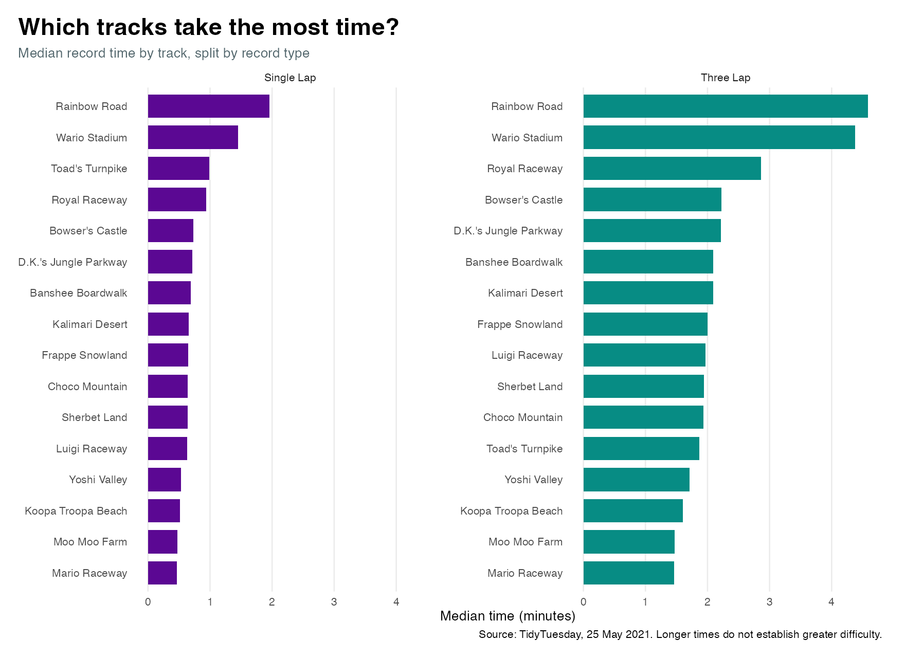
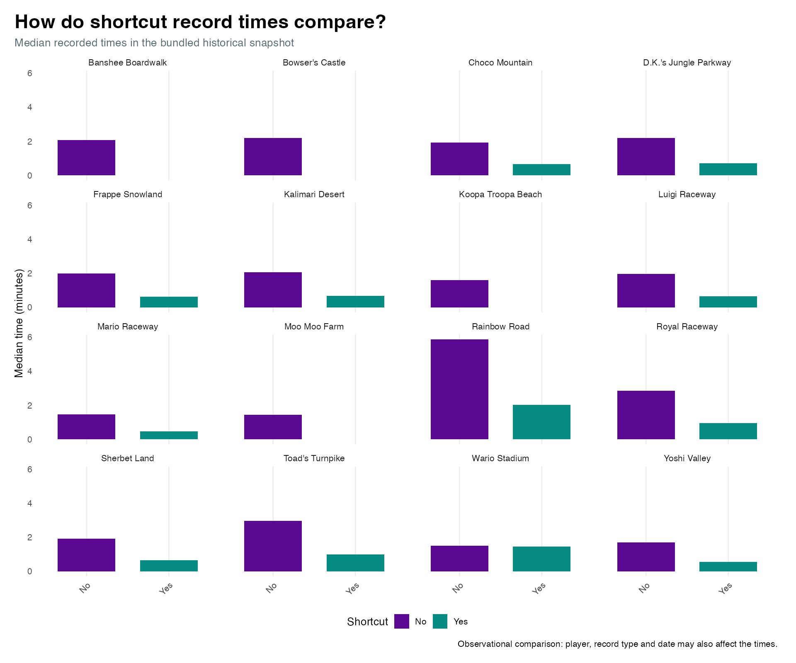

# Taking the long way round Rainbow Road
### A little Mario Kart, a little data, and a question I couldn't resist.

  

I wanted to see how Rainbow Road compared with the other tracks. This small TidyTuesday project explores recorded times by track and asks how shortcut records compare.

**[See the R code →](mario_kart_analysis.R)** · [Explore the snapshot](data/records.csv)



## The two questions

| Question | How I approached it |
|---|---|
| Which tracks take longer? | Compare median recorded times by track, keeping record types separate. |
| How do shortcut records compare? | Compare median times with and without shortcuts within each track. |



## Run it yourself

Open `mario-kart-tt.Rproj`, or start R in this repository's folder:

```r
install.packages(c("tidyverse", "tidytext"))
source("mario_kart_analysis.R")
```

The script reads the bundled `data/records.csv` and writes both PNGs into `final_plots/`. It uses a system font, so you don't need to install Fira Code. The script and chart exports were rerun during the 2026 refresh with R 4.4.1.

## What the charts can tell us

Longer recorded times are not proof that a track is more difficult: track length and record type matter too. The shortcut comparison is observational, and the chart pools record types within each track. Different players, dates and record types may affect the result; this is not a controlled estimate of the benefit of taking a shortcut.

That still leaves a fun starting point for a better question: what changes when we compare like-for-like record types?

## Source

[TidyTuesday, 25 May 2021](https://github.com/rfordatascience/tidytuesday/tree/main/data/2021/2021-05-25). The bundled CSV is a copy of that historical records dataset, included so the analysis can run without a live download. It is not a current leaderboard.

Made by [Steph Boyle](https://stephanieboyle.github.io/) · R · Visualisation · A bit of fun
